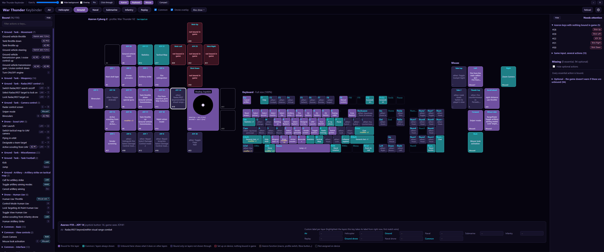
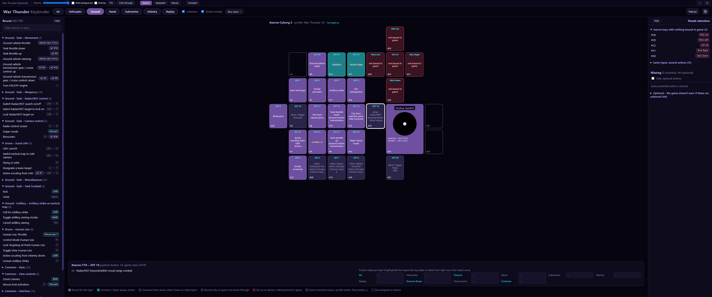

# War Thunder Keybinder
a completely llm code generated electron app that has a nice layout view of your war thunder keybinds, layer switching, the ability to label keys.
it also has the ability to mass edit your keybinds via creating a file you can import the normal war thunder way, but i'm a little sketched out if it may trigger anti cheat, so it has warnings. ymmv.
it also supports showing mouse and an azeron cyborg 2, and the common? keyboard layouts, idk ask claude to add yours if it isn't included.

## Screenshots

The Ground layer with all three panels shown: the Azeron, the keyboard and the mouse.

Each panel can also be shown on its own, here the Azeron and the keyboard.

## Getting started

todo xd

## Notes

:3c

## License

GPL-3.0-only, see [LICENSE](LICENSE). The game data in `data/` comes from War Thunder and belongs to Gaijin Entertainment; the
license covers this project's own code only.

---

For the full reference (every feature, setting, file and limit), see the generated documentation:
[docs/README.md](docs/README.md). It was written by an LLM (Claude) and checked against the code.
